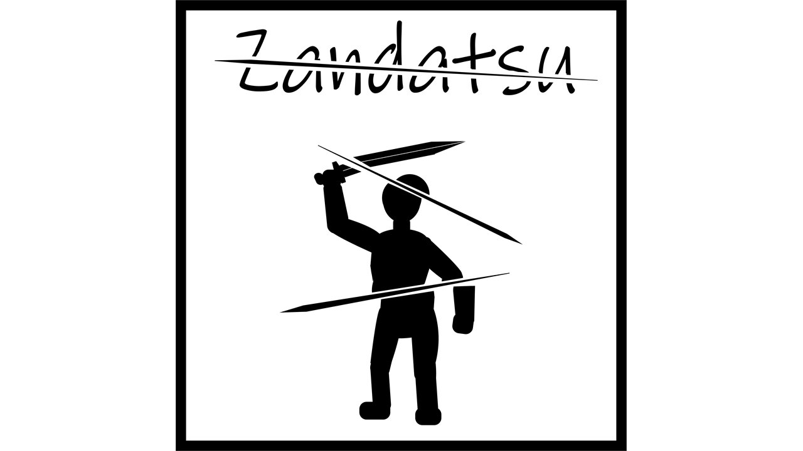

# Zandatsu — free-angle slicing for Blade & Sorcery



Zandatsu lets a fast edge swing cut enemies, weapons, shields and many props along the real plane of the blade, instead of only at the game's joints. It is inspired by Blade Mode in *Metal Gear Rising: Revengeance*.

- **Source version:** 0.7.0
- **Tested game version:** Blade & Sorcery PCVR 1.3.2
- **License:** MIT — see [LICENSE](LICENSE).

## Features

- Cut creatures at almost any angle, including through armour, and cut the corpse or loose pieces again.
- Survivable limb cuts: an enemy can lose an arm or leg, keep fighting or fall, and bleed out.
- Cut weapons, shields, bows and the KharTib crossbow. Remaining weapons keep appropriate mass, balance and spell effects.
- Cut furniture, barrels, pottery, logs, baskets, food and other props, with material-specific cut faces and hollow interiors.
- Grab, throw and re-slice weapon and prop debris.
- Fire-imbued blades char cut surfaces and leave a smouldering rim.
- Optional support for The Outer Rim lightsabers; blaster bolts do not slice enemies.
- Experimental Nomad support with the limitations described below.

## Requirements for players

Blade & Sorcery PCVR, U1.0+. No Harmony or BepInEx is required. Nomad is experimental.

For a manual installation, the final mod folder should look like this:

```text
Mods\Zandatsu\Zandatsu.dll
Mods\Zandatsu\manifest.json
Mods\Zandatsu\HotSteel.png
Mods\Zandatsu\BurnEdge.png
Mods\Zandatsu\thumbnail.png
Mods\Zandatsu\zandatsu.shaders
Mods\Zandatsu\caps\*.png
```

Keep `zandatsu.shaders`: it contains both the advanced burnt-rim shader and the GPU mesh-capture shader used for compressed models. When updating, replace the whole `Mods\Zandatsu` folder.

## Build from source

### Prerequisites

- .NET SDK 8.0 or newer.
- Internet access for the first NuGet restore of `Microsoft.NETFramework.ReferenceAssemblies` 1.0.3.
- Your own Blade & Sorcery 1.3.2 installation, or the reference DLLs listed in [references/README.md](references/README.md).

Game and Unity DLLs are **not included in this repository**. They are only needed as compile-time references and must not be included in a released mod.

### Option A — build against an installed game

From the repository root:

```bash
dotnet build -c Release -p:GameDir="C:\Games\Blade & Sorcery"
```

Replace the example path with your own game installation. You can also set the `BAS_GAME_DIR` environment variable instead of passing `GameDir`.

This builds the mod and copies the DLL, manifest, textures, shader bundle and thumbnail into:

```text
BladeAndSorcery_Data\StreamingAssets\Mods\Zandatsu
```

### Option B — build with a local references folder

Copy the required DLLs from your own installation into `references`, then run:

```bash
dotnet build -c Release
```

The output is:

```text
bin\Release\Zandatsu.dll
```

No files are copied into a game installation in this mode. To package the mod, copy the built DLL and `manifest.json` into a `Zandatsu` folder, then copy the contents of `assets` into that same folder.

## Compressed-mesh troubleshooting

Some tables, crates, chairs, lamps and fruit use compressed vertex data that cannot be read through the normal CPU path. Zandatsu reads these through a geometry shader that writes into a GPU buffer, which requires D3D11.1.

If such an object does not cut:

1. Check that `Mods\Zandatsu\zandatsu.shaders` exists.
2. Update the graphics driver.
3. Look for `read back wrong` and `corner not written` in `Player.log`.

On some driver/API configurations the capture shader may be accepted but write nothing. There is currently no CPU fallback; the object remains intact and breakable objects retain their normal game behaviour.

Log location:

```text
%USERPROFILE%\AppData\LocalLow\Warpfrog\BladeAndSorcery\Player.log
```

Mod log lines start with `[Zandatsu]`.

## Nomad notes

Nomad support is experimental. The mod can be compiled against the PC reference assemblies, but it must be tested on Nomad before publication.

- Omit `zandatsu.shaders` from a Nomad package. The advanced PC burnt rim is replaced by the mod's simple-rim fallback.
- D3D11.1 mesh capture is not supported or verified on Nomad. Compressed models may not cut without it.
- Test cut props, bows, debris recutting, lighting, performance and memory use carefully.

## Shader sources

The Unity shader sources and the asset-bundle builder are in `sdk/Zandatsu`:

- `BurnEdge.shader` — advanced PC burnt rim;
- `MeshCapture.shader` — GPU readback for compressed meshes;
- `Editor/ZandatsuBundleBuilder.cs` — bundle build entry point.

The prebuilt PC bundle is `assets/zandatsu.shaders`. Rebuilding it requires the Blade & Sorcery SDK and a compatible Unity editor; it is not required to compile `Zandatsu.dll`.

## Test bench

`lab/ZandatsuLab.cs` is an optional in-game test bench. It is not part of the released mod and stays inactive unless the game is launched with `-zandatsulab`.

Build and install it with:

```bash
dotnet build lab/ZandatsuLab.csproj -c Release -p:GameDir="C:\Games\Blade & Sorcery"
```

Example PCVR mock-HMD run:

```bash
steam.exe -applaunch 629730 -vrmode mockhmd -level Arena -skipintro -skipmodswarning -zandatsulab all
```

Results are written under `%USERPROFILE%\AppData\LocalLow\Warpfrog\BladeAndSorcery\ZandatsuLab`. Some optional scenarios require The Outer Rim or Realistic Deaths. **Never include ZandatsuLab in the public mod archive.**

## Project layout

```text
src/                 C# mod source
assets/              Runtime textures, thumbnail and PC shader bundle
sdk/Zandatsu/        Shader sources and bundle builder
lab/                 Optional in-game test bench
references/          Local-only game/Unity reference DLLs (not tracked)
manifest.json        Mod manifest
Zandatsu.csproj      Portable build project
```

## Credits and third-party notices

- Idea, in-game testing, HotSteel texture and AI-generated BurnEdge texture: **StainlessHalo**.
- Code written with **Claude Code** (Anthropic, Claude Opus) and **Kimi** (Moonshot AI).
- Inspired by *Metal Gear Rising: Revengeance* (PlatinumGames / Konami); not affiliated with them.
- Blade & Sorcery and ThunderRoad are property of their respective owners. No game assemblies or extracted game assets are included.
- The mod uses the game's own materials, effects and sounds at runtime.

The original source code and original assets in this repository are available under the MIT License. This license does not grant rights to Blade & Sorcery, Unity, or other third-party software.
